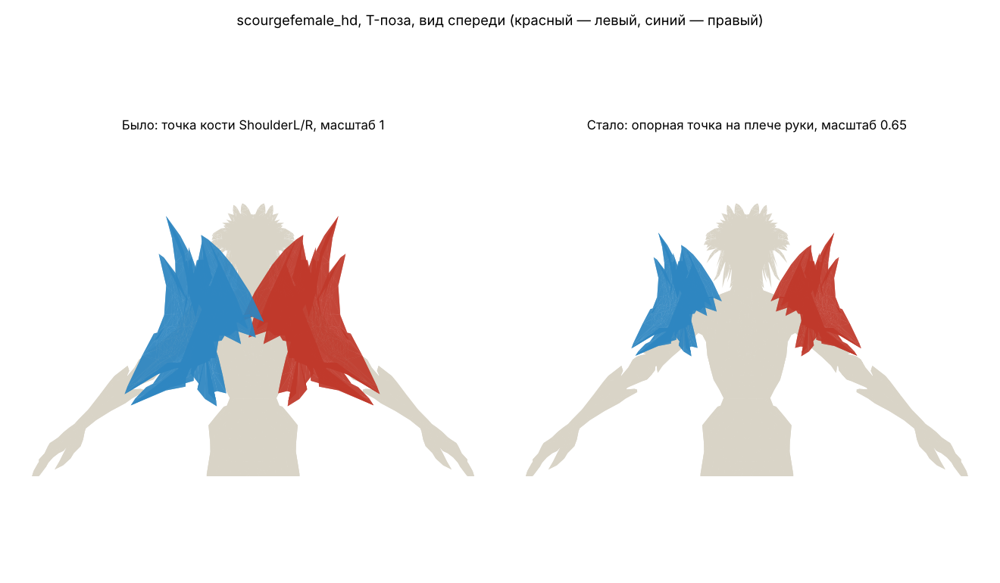

# Наплечники WoW Forever: размер и привязка

Опора — исходники wow.export **v0.2.19** (та же версия в `asset.generator` всех файлов) и присланные экспорты нежити `scourgefemale_hd` с Item 271754 (модели `shoulder_armor_skybornec60_d_01_l/_r`).

## Итог

В игре наплечник этой нежити ставится так:

```
наплечник = кость bone_Arm{L|R} × сдвиг в опорную точку × масштаб 0.65
```

| Сторона | Кость | Опорная точка (поза покоя, оси GLB) | Масштаб |
|---|---|---|---|
| L | `bone_ArmL` | (−0.029423, 1.647001, −0.146441) | 0.65 |
| R | `bone_ArmR` | (−0.029423, 1.647000, 0.146448) | 0.65 |

Дополнительного поворота нет. Опорная точка — это центр служебной кости наплечника, дочерней к кости руки. Её постоянный масштаб 0.65 и уменьшает наплечник.



## Почему в приложении было неправильно

1. **Размер.** Масштаб 0.65 хранится в анимационных данных служебной кости. GLB без анимаций его не содержит. Поэтому в приложении наплечники были в 1/0.65 ≈ **1.54 раза** больше игровых.
2. **Место.** `attachShoulderAssets` вешал наплечник в опорную точку `bone_ShoulderL/R` — основание ключицы почти у позвоночника. Наплечники заходили за середину тела и перекрывались у шеи. `attachDetachedShoulders` сдвигал их на мировую матрицу `bone_Root` (+1.177 по Y) — значение подобрано на глаз.

## Как получены значения (без подбора на глаз)

- **Совпадение моделей.** Вершины групп `Shoulder (L/R)_Item271754_0` в обоих OBJ совпали с вершинами GLB Skyborne: RMS 3·10⁻⁸ после подбора преобразования. Это одна и та же модель.
- **Поза кости руки.** Её фактическая поза в каждом OBJ восстановлена по вершинам тела, привязанным только к `bone_ArmL/R` (42 вершины на сторону). Точку покоя и веса дал GLB с анимациями из того же экспорта. RMS 3·10⁻⁸, чистый поворот без масштаба.
- **Особенность wow.export.** В OBJ надетые предметы дополнительно повёрнуты на угол модели в окне просмотра (`getAttachmentTransform` умножает на `model_matrix`), а тело — нет.
- **Решение.** Нашлись два угла окна просмотра (−90.571° и −92.29°), при которых положение наплечника относительно руки в двух OBJ с разными позами совпадает с точностью 10⁻⁶. Углы получились одинаковыми для левой и правой стороны, хотя считались независимо.
- **Результат.** Остаток — равномерный масштаб 0.65000 и сдвиг, равный центру служебной кости наплечника (совпадение до 10⁻⁵ с центрами `bone_157`/`bone_161` в первом GLB и `bone_156`/`bone_155` в анимированном). Номера безымянных костей в разных экспортах разные, поэтому привязка идёт к именованной `bone_Arm{L|R}`.
- **Воспроизведение.** Весь расчёт повторяет `tools/derive_shoulder_attachment.py`. Он отказывается выдавать результат, если любое из условий выше не выполнено точно.

## Что изменено в коде (`src/`)

- `CONFIRMED_SHOULDER_ATTACHMENTS.scourgefemale_hd` — подтверждённые значения из таблицы.
- Точка крепления описывается как `{ bone, position, scale }`. Меш ставится под `bone` с матрицей `inv(bone_world) × model_world × T(position) × S(scale)`, поэтому следует за рукой при анимации.
- `attachShoulderAssets` и `attachDetachedShoulders` без подтверждённых данных ничего не двигают: выдают ошибку или возвращают `missing`.
- `deriveShoulderAttachments` (в браузере) сопоставляет OBJ без анимации с GLB предмета и убирает поворот окна просмотра. У этой модели wow.export даже в режиме No Animation даёт кости кадр анимации, поэтому для таких моделей нужен скрипт из `tools/`.
- Браузерный шим `wf-armory-shoulder-fix.js` повторяет ту же логику.
- Тесты: 13 из 13, включая реальные GLB.
- `wf-wow-model-viewer.js` и Release не изменялись.

## Использование

```js
const att = WFArmoryImport.CONFIRMED_SHOULDER_ATTACHMENTS.scourgefemale_hd;
const { blob } = await WFArmoryImport.attachShoulderAssets(bodyGlb, [
  { side: 'L', file: leftGlb, attachment: att.L },
  { side: 'R', file: rightGlb, attachment: att.R }
]);
```

## Другие расы и модели

Значения действуют для `scourgefemale_hd`. Для другой модели персонажа нужны те же три выгрузки из wow.export с любыми надетыми наплечниками:

1. GLB с галочкой **Export animations**.
2. Два OBJ в разных позах (разные анимации или кадры).
3. GLB надетых моделей наплечников (левый и правый).

Затем: `python3 -I tools/derive_shoulder_attachment.py CHARACTER.glb POSE1.obj POSE2.obj ITEM_L.glb ITEM_R.glb`.

## Ограничения

- Модель в приложении стоит в T-позе, а в игре — в анимации. Положение наплечника относительно руки и его размер теперь игровые, но поза тела останется T-позой, пока приложение не проигрывает анимации (например, Stand из GLB с анимациями).
- Игровые GLB и OBJ в репозиторий не добавлены (`.gitignore`): репозиторий публичный.
